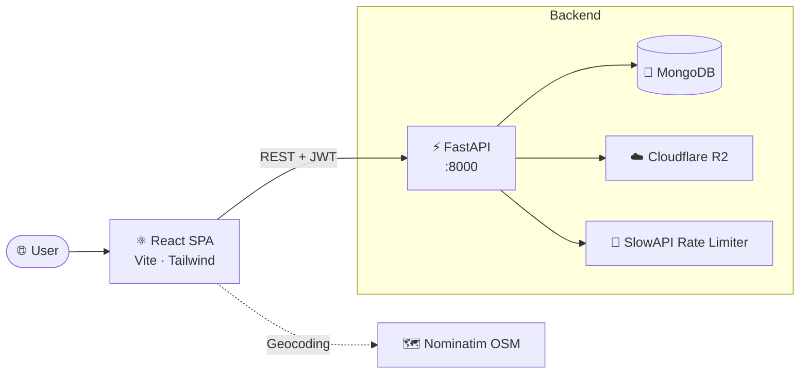

<div align="center">


# Vypaar Setu

### *The Bridge Between Local Businesses & Customers Across India* 🇮🇳

A modern, full-stack local business directory — discover, review and connect with verified businesses near you.

[](https://react.dev/)
[](https://vitejs.dev/)
[](https://tailwindcss.com/)
[](https://fastapi.tiangolo.com/)
[](https://www.mongodb.com/)
[](https://www.cloudflare.com/products/r2/)
[](https://jwt.io/)

[✨ Features](#-features) •
[🧰 Tech Stack](#-tech-stack) •
[🏗️ Architecture](#️-architecture) •
[🚀 Getting Started](#-getting-started) •
[🔌 API](#-api-overview) •
[👥 Team](#-meet-the-team)

</div>

---

## 🌟 About

**Vypaar Setu** (*"business bridge"*) is a Justdial/Yelp-style platform that helps people find trusted local services and helps business owners get discovered. It pairs a fast **React 19** single-page app with an asynchronous **FastAPI + MongoDB** backend, **Cloudflare R2** media storage, and a role-based admin panel for verifying listings.

---

## ✨ Features

<table>
<tr>
<td width="33%" valign="top">

### 🌐 For Customers
- 🔎 Search by name, category, city or pincode
- 📍 Auto-detect city & pincode from your location
- 🗂️ Browse categories and subcategories
- ⭐ Read and write ratings & reviews
- 🔖 Bookmark favourite businesses
- 📞 Contact via phone, WhatsApp or quote form

</td>
<td width="33%" valign="top">

### 💼 For Business Owners
- 📝 Submit a business listing application
- 🖼️ Upload logo & gallery images (Cloudflare R2)
- ✏️ Edit approved listings from the dashboard
- 📬 Receive customer leads
- 📊 Track applications and listing status

</td>
<td width="33%" valign="top">

### 🛡️ For Admins
- ✅ Approve or reject applications with a reason
- 🏅 Toggle *Verified* and *Featured* badges
- 🗃️ Manage categories & subcategories
- 📥 View and moderate leads
- 📈 Platform stats at a glance

</td>
</tr>
</table>

### 🔒 Platform Highlights
- **Async-first backend** using Motor for non-blocking MongoDB access
- **JWT auth** with access + refresh tokens and hashed passwords
- **Rate limiting** with SlowAPI on auth, search, upload and admin routes
- **Security middleware**: trusted hosts, CORS control, security headers, request IDs and structured logging

---

## 🧰 Tech Stack

| Layer | Technologies |
| :--- | :--- |
| **Frontend** | React 19, Vite 8, React Router 7, Tailwind CSS 4, Framer Motion, Lucide Icons |
| **State & HTTP** | React Context, Axios (with token-refresh interceptor), React Hot Toast |
| **Backend** | FastAPI, Uvicorn, Pydantic v2 |
| **Database** | MongoDB (Atlas or local) via Motor / PyMongo |
| **Storage** | Cloudflare R2 (S3-compatible, via Boto3) |
| **Auth & Security** | python-jose (JWT), Passlib, SlowAPI, custom security middleware |
| **Hosting** | Vercel (frontend) |

---

## 🏗️ Architecture



| Service | Default URL |
| :--- | :--- |
| Frontend (Vite dev server) | `http://localhost:5173` |
| Backend API | `http://localhost:8000` |
| Swagger UI | `http://localhost:8000/docs` |
| ReDoc | `http://localhost:8000/redoc` |
| Health check | `http://localhost:8000/health` |

---

## 📂 Project Structure

```text
.
├── backend/
│   ├── app/
│   │   ├── core/          # config, database, JWT auth, redis
│   │   ├── middleware/    # rate limit, security headers, logging, request IDs
│   │   ├── models/        # Pydantic schemas
│   │   ├── routers/       # API endpoints (auth, business, admin, leads, reviews…)
│   │   ├── services/      # business logic
│   │   ├── utils/         # Cloudflare R2 client, serializers, validators
│   │   └── exceptions.py  # global exception handlers
│   ├── scripts/           # DB inspection / restore helpers
│   ├── indexes.py         # MongoDB index creation
│   ├── main.py            # FastAPI app entry point
│   ├── run.py             # Uvicorn runner
│   └── requirements.txt
│
├── Frontend/
│   ├── public/            # logos, favicon, social preview image
│   ├── src/
│   │   ├── components/    # Navbar, Footer, cards, modals, skeletons
│   │   ├── context/       # AuthContext
│   │   ├── pages/         # public, auth, user and admin pages
│   │   ├── services/      # Axios API client
│   │   ├── App.jsx        # routes & layouts
│   │   └── main.jsx
│   ├── index.html
│   └── package.json
│
└── README.md
```

---

## 🚀 Getting Started

### ✅ Prerequisites
- **Node.js** 18+ and **npm**
- **Python** 3.9+ and **pip**
- **MongoDB** running locally, or a MongoDB Atlas connection string
- A **Cloudflare R2** bucket (required by the backend config for image uploads)

### 1️⃣ Backend (FastAPI)

```bash
cd backend

# create & activate a virtual environment
python -m venv venv
.\venv\Scripts\activate        # Windows (PowerShell)
# source venv/bin/activate     # macOS / Linux

# install dependencies
pip install -r requirements.txt

# configure environment
copy .env.example .env         # Windows   (cp .env.example .env on macOS/Linux)
# then edit .env with your MongoDB URI, JWT secrets and R2 credentials

# run the server
uvicorn main:app --host 0.0.0.0 --port 8000 --reload
```

> [!WARNING]
> Never commit your `.env` file. It contains database credentials, JWT secrets and storage keys.

### 2️⃣ Frontend (React + Vite)

```bash
cd Frontend
npm install
copy .env.example .env         # Windows   (cp .env.example .env on macOS/Linux)
npm run dev
```

Open **(https://business-listing-website-alpha.vercel.app/)** 🎉

### 🏭 Production Build

```bash
cd Frontend
npm run build      # outputs to Frontend/dist
npm run preview    # preview the production build locally
```

For the backend in production, run without `--reload`, for example:

```bash
pip install gunicorn
gunicorn -w 4 -k uvicorn.workers.UvicornWorker main:app --bind 0.0.0.0:8000
```

---

## 🔐 Environment Variables

### Backend (`backend/.env`)

| Variable | Description | Example |
| :--- | :--- | :--- |
| `MONGO_URI` | MongoDB connection string | `mongodb://localhost:27017` |
| `DATABASE_NAME` | Database name | `nearlly_db` |
| `SECRET_KEY` | JWT access-token signing key | *generate a long random string* |
| `REFRESH_SECRET_KEY` | JWT refresh-token signing key | *generate a different random string* |
| `ALGORITHM` | JWT algorithm | `HS256` |
| `ACCESS_TOKEN_EXPIRE_MINUTES` | Access token lifetime | `30` |
| `REFRESH_TOKEN_EXPIRE_DAYS` | Refresh token lifetime | `7` |
| `R2_ACCOUNT_ID` / `R2_ACCESS_KEY_ID` / `R2_SECRET_ACCESS_KEY` | Cloudflare R2 credentials | — |
| `R2_BUCKET_NAME` / `R2_PUBLIC_URL` | R2 bucket & public URL | `https://your-bucket.r2.dev` |
| `CORS_ORIGINS` | Allowed frontend origins (comma-separated) | `http://localhost:5173` |
| `TRUSTED_HOSTS` | Allowed hosts (comma-separated) | `localhost,127.0.0.1` |
| `USE_RATE_LIMITING` | Toggle SlowAPI rate limiting | `true` |

> 💡 Generate a strong secret with:
> `python -c "import secrets; print(secrets.token_urlsafe(32))"`

### Frontend (`Frontend/.env`)

| Variable | Description |
| :--- | :--- |
| `VITE_API_URL` | Backend API base URL (e.g. `http://localhost:8000/api`) |
| `VITE_CONTACT_EMAIL`, `VITE_CONTACT_PHONE`, `VITE_CONTACT_ADDRESS` | Footer contact details |
| `VITE_SOCIAL_FACEBOOK`, `VITE_SOCIAL_INSTAGRAM`, `VITE_SOCIAL_LINKEDIN`, `VITE_SOCIAL_TWITTER` | Social links |

---

## 🔌 API Overview

Full interactive docs are available at **`/docs`** while the backend is running.

<details>
<summary><b>🔐 Auth & Users</b></summary>

| Method | Endpoint | Description |
| :--- | :--- | :--- |
| `POST` | `/api/auth/register` | Create an account |
| `POST` | `/api/auth/login` | Log in, receive access & refresh tokens |
| `POST` | `/api/auth/refresh` | Get a new access token |
| `GET` | `/api/me` | Current user info |
| `PUT` | `/api/users/{user_id}` | Update profile |

</details>

<details>
<summary><b>🏪 Businesses & Applications</b></summary>

| Method | Endpoint | Description |
| :--- | :--- | :--- |
| `GET` | `/api/businesses` | List businesses |
| `GET` | `/api/businesses/featured` | Featured businesses |
| `GET` | `/api/businesses/{id}` | Business details |
| `GET` | `/api/search` | Search with filters & pagination |
| `GET` | `/api/my-businesses` | Businesses owned by the current user |
| `PUT` | `/api/business/{id}` | Update a business (owner) |
| `POST` | `/api/business/apply` | Submit a listing application |
| `GET` | `/api/my-applications` | Current user's applications |

</details>

<details>
<summary><b>📂 Categories, Reviews, Leads & Bookmarks</b></summary>

| Method | Endpoint | Description |
| :--- | :--- | :--- |
| `GET` | `/api/categories` · `/api/subcategories` | List categories / subcategories |
| `POST` / `PUT` / `DELETE` | `/api/categories`, `/api/subcategories` | Manage categories *(admin)* |
| `GET` / `POST` | `/api/reviews/{business_id}` · `/api/reviews` | Read / submit reviews |
| `POST` | `/api/leads` | Send an enquiry to a business |
| `GET` | `/api/my-leads` · `/api/my-business-leads` | Leads sent / received |
| `GET` / `POST` / `DELETE` | `/api/bookmarks…` | Manage bookmarks |

</details>

<details>
<summary><b>🛡️ Admin & Media</b></summary>

| Method | Endpoint | Description |
| :--- | :--- | :--- |
| `GET` | `/api/admin/applications` | List applications |
| `PUT` | `/api/admin/applications/{id}/approve` | Approve an application |
| `PUT` | `/api/admin/applications/{id}/reject` | Reject with a reason |
| `DELETE` | `/api/admin/applications/{id}` | Delete an application |
| `DELETE` | `/api/admin/businesses/{id}` | Delete a business |
| `PUT` | `/api/admin/businesses/{id}/verify` · `/feature` | Toggle verified / featured |
| `GET` | `/api/leads` | All leads |
| `POST` | `/api/upload` | Upload an image to Cloudflare R2 |
| `GET` | `/api/banners` · `/api/quick-services` · `/api/public-stats` | Home page data |

</details>

---

## 👥 Meet the Team

Built with ❤️ by students of **GLA University**:

| | Name | University |
| :---: | :--- | :--- |
| 👨‍💻 | **Krishna Goyal** | GLA University |
| 👨‍💻 | **Ujjwal Kaushik** | GLA University |
| 👨‍💻 | **Aryan Vashistha** | GLA University |
| 👨‍💻 | **Abhishek Raj** | GLA University |

---

<div align="center">

**Vypaar Setu** — *Empowering Local Businesses Across India.*

⭐ If you like this project, give it a star!

</div>
